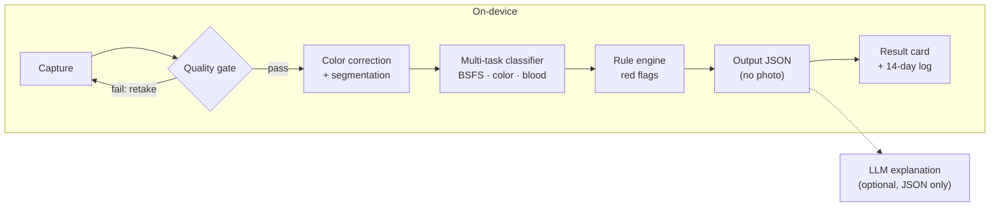

# POOING

**On-device stool image analysis for gut-health self-tracking**

Take one photo of your stool in a Western (sitting) toilet before flushing, and POOING tells you, entirely on your device, the stool form on the Bristol Stool Form Scale (BSFS 1–7), its color, and whether visible blood is suspected. It keeps a private log and shows 7/14-day trends with "consider seeing a doctor" signals.

> **Not a diagnostic tool.** POOING does not diagnose or predict any disease (colorectal cancer, IBD, etc....) 
> And cannot replace a fecal occult blood test or medical advice. It is a recording and observation aid.

> **Status:** Proposal stage (Open Source Software term project, Fall 2026). Code, dataset and models are not released yet.

---

## Features

- **BSFS classification**: 7 types plus 3 groups (hard 1–2 / normal 3–4 / soft 5–7), with calibrated confidence
- **Color classification**: brown, yellow, green, black, red, pale, other
- **Visible blood flag**: none / suspected / present
- **Quality gate**: rejects blurry, dark, occluded or cropped photos and asks for a retake
- **Rule-based red flags**: black, red or pale stool and persistent hard/soft trends trigger fixed guidance text
- **Trends**: 7/14-day summaries stored only on the device
- **Optional LLM explanation**: explains the structured result in plain language; never sees the photo

## How it works



1. **Quality gate** (MobileNetV3-Small): multi-label image quality flags
2. **Segmentation** (DeepLabV3+ / MobileNetV3): background, toilet water, stool
3. **Color correction**: uses the white porcelain of the toilet bowl as the white reference
4. **Multi-task classifier** (EfficientNet-B0 shared backbone):
   - BSFS head with ordinal regression (CORAL)
   - Color head using image embedding + CIELAB statistics inside the stool mask
   - Blood head tuned for high sensitivity
5. **Rule engine**: fixed red-flag rules that neither the model nor the LLM can override
6. **Export**: ONNX → INT8, runs in the browser via onnxruntime-web

## Output

Each capture produces one JSON object. The photo itself is never part of the output.

```json
{
  "schema_version": "0.1",
  "quality": { "ok": true, "flags": [] },
  "bsfs": { "type": 4, "group": "normal", "confidence": 0.61, "top2": [4, 5] },
  "color": { "label": "brown", "confidence": 0.88, "white_balance": "bowl_reference" },
  "visible_blood": { "status": "none", "score": 0.04 },
  "red_flags": [],
  "advice_codes": ["BSFS_NORMAL"],
  "trend": { "window_days": 14, "group_counts": { "hard": 2, "normal": 9, "soft": 1 } },
  "disclaimer_code": "NOT_A_DIAGNOSIS"
}
```

If confidence is below a calibrated threshold, `bsfs.type` is `null` and only the top-2 candidates are shown.

## Data

There is no publicly downloadable, BSFS-labeled human stool image dataset. POOING therefore uses:

| Source | Size | Use |
| --- | --- | --- |
| **Synthetic clay dataset** (built for this project) | 2,000–3,000 images (target) | Primary training; will be released under CC BY 4.0 |
| Negative/background photos (empty bowl, paper, urine) | 300–500 images | Quality gate training |
| Academic datasets (Zhou et al. 2021, Zhang et al. 2022) | 1,118–3,275 images | Fine-tuning and real-domain evaluation, **only if access is granted; never redistributed** |

The synthetic dataset follows the approach of Hachuel et al. (play-doh stool models). The domain gap between synthetic and real images is reduced with **AdaBN** (re-estimating BatchNorm statistics on unlabeled real photos) and measured explicitly in the evaluation.

## Evaluation

| Task | Primary metric |
| --- | --- |
| BSFS (7 types) | Quadratic weighted kappa, ±1 accuracy |
| BSFS (3 groups) | Balanced accuracy |
| Color | Macro-F1 |
| Visible blood | Sensitivity at specificity ≥ 0.70 |
| Calibration | ECE |

A baseline experiment compares zero-shot vision LLMs with the dedicated model on accuracy, answer consistency across repeated runs, latency, cost and privacy.

## Privacy

- Inference runs fully on the device; the original photo is discarded right after inference by default
- No server upload; any data donation for research is opt-in with explicit consent and EXIF stripping
- Model files are distributed with SHA-256 hashes

## Checklist

- [ ] Send data access requests to the research teams (Zhou et al., Zhang et al., DLSUC)
- [ ] Write the synthetic clay capture protocol
- [ ] Set up the repository skeleton and CI
- [ ] Capture and label the synthetic clay dataset
- [ ] Train the quality gate and segmentation models
- [ ] Implement bowl-based color correction
- [ ] Decide on fine-tuning depending on external data availability
- [ ] Train and evaluate the multi-task classifier
- [ ] Apply AdaBN and measure the synthetic-to-real gap
- [ ] Run the vision LLM baseline comparison
- [ ] Implement the rule engine and the output JSON Schema
- [ ] Build the PWA capture and result screens
- [ ] Write the datasheet and model card
- [ ] Release on PyPI and prepare the presentation

## Planned repository layout

> This layout is tentative and may change as development progresses.

```
pooing/
├── src/pooing/
│   ├── quality/      # quality gate
│   ├── segment/      # segmentation + color correction
│   ├── classify/     # multi-task classifier
│   ├── rules/        # red-flag rule engine
│   ├── trend/        # log aggregation
│   ├── explain/      # optional LLM explanation layer
│   └── schema/       # versioned output JSON Schema
├── training/         # configs, train.py, eval.py, vlm_baseline.py
├── data/             # synthetic capture protocol, datasheet, download scripts
├── models/           # MODEL_CARD.md
├── app/              # PWA: capture → onnxruntime-web → result card
└── tests/
```

## Contributing

저의 레포지토리에 관심을 가져주셔서 감사합니다. 하지만 아직은 개인 텀 프로젝트이므로, 기여는 받지 않고 solo로 작업할 예정입니다.

Thank you for your interest in this repository. As this is currently a personal term project, I am working on it solo and not accepting contributions.

## License

- Code: Apache-2.0
- Synthetic dataset: CC BY 4.0
- Weights trained only on the synthetic dataset: Apache-2.0
- Weights fine-tuned on external datasets: subject to the original data agreements

## References

- Lewis, S. J., & Heaton, K. W. (1997). Stool form scale as a useful guide to intestinal transit time. *Scandinavian Journal of Gastroenterology*, 32(9), 920–924.
- Hachuel, D., et al. (2019). [Augmenting Gastrointestinal Health: A Deep Learning Approach to Human Stool Recognition and Characterization in Macroscopic Images](https://arxiv.org/abs/1903.10578).
- Zhou, J., et al. (2021). [Stool Image Analysis for Precision Health Monitoring by Smart Toilets](https://proceedings.mlr.press/v149/zhou21a.html). *MLHC*.
- Zhang, J., et al. (2022). [Human Stools Classification for Gastrointestinal Health Based on an Improved ResNet18 Model with Dual Attention Mechanism](https://openaccess.thecvf.com/content/CVPR2022W/CVPM/papers/Zhang_Human_Stools_Classification_for_Gastrointestinal_Health_Based_on_an_Improved_CVPRW_2022_paper.pdf). *CVPR Workshops*.
- Lee, et al. (2025). [Deep Learning Model Using Stool Pictures for Predicting Endoscopic Mucosal Inflammation in Patients With Ulcerative Colitis](https://journals.lww.com/ajg/fulltext/2025/01000/deep_learning_model_using_stool_pictures_for.33.aspx). *American Journal of Gastroenterology*.
- Ioffe, S., & Szegedy, C. (2015). [Batch Normalization: Accelerating Deep Network Training by Reducing Internal Covariate Shift](https://arxiv.org/abs/1502.03167). *ICML*.
- Santurkar, S., et al. (2018). [How Does Batch Normalization Help Optimization?](https://papers.nips.cc/paper/7515-how-does-batch-normalization-help-optimization) *NeurIPS*.
- Li, Y., et al. (2017). [Revisiting Batch Normalization for Practical Domain Adaptation](https://arxiv.org/abs/1603.04779). *ICLR Workshop*.

---

Open Source Software term project, SeoulTech, Fall 2026 · JeYoung Park